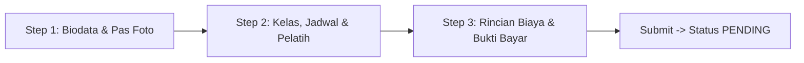

# Product Requirement Document (PRD) — PT Tirya Lumba
## Portal Publik (Landing Page) & Dasbor Manajemen (Admin & Pengelola)

> **Catatan Penggunaan Dokumen:**
> Dokumen ini merupakan spesifikasi fungsional dan logika bisnis resmi sistem PT Tirya Lumba. Dokumen ini dirancang sebagai acuan mutlak bagi AI / Pengembang yang bertugas **merombak gaya visual (UI/UX Styling)** tanpa mengubah satu pun alur fungsional, logika bisnis (*business logic*), skema data, maupun kontrak REST API yang sudah berjalan.

---

## 1. Arsitektur Umum & Konsep Sistem

Sistem PT Tirya Lumba terdiri dari 3 aplikasi terpisah dalam satu lingkungan kerja:
1. **Frontend 1 (Landing Page & Portal Pengguna):** Dibangun dengan **Next.js (App Router)**, TypeScript, dan Tailwind CSS. Berfungsi sebagai portal informasi publik, katalog program, formulir pendaftaran murid & pelatih multi-step, serta dasbor profil pribadi murid & pelatih.
2. **Frontend 2 (Dasbor Manajemen):** Dibangun dengan **React (Vite)**, TypeScript, dan Tailwind CSS. Berfungsi sebagai Single Page Application (SPA) operasional khusus internal untuk Admin Pusat (`ADMIN`) dan Pengelola Kolam Cabang (`POOL_MANAGER`).
3. **Backend Server:** Dibangun dengan **Node.js, Express.js, TypeScript, Prisma ORM, dan MySQL**. Menyediakan REST API dengan autentikasi JWT (Bearer token + HTTP-Only Cookie) dan otorisasi *Role-Based Access Control* (RBAC).

### Tingkatan Hak Akses (Role Hierarchy)
- `ADMIN`: Super Admin pusat dengan otoritas penuh atas seluruh cabang kolam renang, master data, antrean persetujuan, dan akun pengelola.
- `POOL_MANAGER`: Pengelola operasional cabang kolam renang. Akses dibatasi secara ketat (*scoped*) hanya pada kolam renang miliknya (`locationId`).
- `INSTRUCTOR`: Pelatih renang berlisensi yang telah disetujui. Memiliki akses melihat jadwal mengajar, total murid aktif yang diajar per sesi, dan mengelola jadwal mandiri via token bulanan.
- `STUDENT`: Murid yang pendaftarannya telah disetujui. Memiliki kuota pertemuan aktif (`activeSessions`), pengingat jadwal, profil pelatih pembimbing, dan riwayat presensi kehadiran.
- `USER`: Pengguna terautentikasi baru yang telah memverifikasi email (OTP), tetapi belum mendaftar atau sedang menunggu verifikasi sebagai murid/pelatih.

---

## 2. Spesifikasi Fungsional Frontend 1: Landing Page (`client/landing-page`)

### 2.1 Halaman Beranda (`/`)
Halaman utama publik yang memadukan profil lembaga renang, katalog paket kolam renang, dan statistik riil.

#### Komponen & Logika Beranda:
1. **Hero Section (`HeroSection`):**
   - Menampilkan tajuk selamat datang unik bertema renang profesional.
   - Menampilkan total kolam renang mitra yang aktif.
   - Dua tombol Call to Action (CTA): *"Daftar Sekarang"* (mengarah ke `/daftar`) dan *"Tentang Kami"* (smooth scroll ke `/#tentang-kami`).
2. **Brand Section (`BrandSection`):**
   - Menampilkan logo-logo merek atau instansi mitra PT Tirya Lumba.
3. **Katalog Program Renang (`ProgramSection`):**
   - Menampilkan daftar kartu paket program kolam renang dari `GET /packages`, `GET /locations`, dan `GET /areas`.
   - **Pagination:** Ditampilkan per 6 kartu program per halaman (parameter query `?halaman=N`).
   - **Informasi Kartu:** Nama kolam renang, kategori kemitraan, wilayah, harga paket kelas (Reguler / Privat), serta tombol tautan koordinat langsung ke Google Maps (`mapUrl`).
   - Tombol CTA header untuk langsung mendaftar sebagai murid (`/daftar/murid`).
4. **Tentang Kami (`AboutSection` - `/#tentang-kami`):**
   - Rangkuman profil PT Tirya Lumba, filosofi melatih dari pemula hingga pembinaan atlet.
   - Tautan modern dengan animasi hover dari bawah (*underline/hover reveal*): *"Kenal kami lebih dalam"*.
5. **Kenapa Pilih Kami (`WhyUsSection` - `/#kenapa-pilih-kami`):**
   - **Statistik Riil Dinamis:** Menarik data langsung dari endpoint publik server `GET /api/stats`.
   - Menampilkan 4 kartu metrik utama:
     1. **Total Murid Terdaftar** (`totalStudents`)
     2. **Total Pelatih Berlisensi** (`totalInstructors`)
     3. **Total Kolam Renang Mitra** (`totalPools` / `totalPartnerPools`)
     4. **Total Wilayah Layanan** (`totalAreas`)
   - Tombol CTA *"Daftar Sebagai Murid"* (`/daftar/murid`).
6. **Global Navigation (Header / Navbar):**
   - Logo resmi PT Tirya Lumba dengan tautan ke `/`.
   - Menu navigasi (Beranda, Program, Tentang Kami, Kontak).
   - **Deteksi Auth Dinamis:** Jika pengguna belum login, tampilkan tombol *"Login"* dan *"Daftar"*. Jika sudah login, tombol berubah menjadi tombol pintas *"Profil Saya"* / *"Dasbor"*.
7. **Global Footer:**
   - Informasi kontak, alamat kantor, tautan WhatsApp CS, sosial media, dan sitemap singkat.

---

### 2.2 Modul Autentikasi (`/register`, `/login`, `/forgot-password`, `/reset-password`)

#### A. Registrasi Akun (`/register`)
- Input: Nama Lengkap (`fullName`), Email (`email`), dan Kata Sandi (`password` minimal 6 karakter).
- Submit memanggil `POST /api/auth/register`.
- Server menerbitkan kode OTP 6 digit ke email pengguna.
- Sistem memunculkan form verifikasi OTP interaktif dengan *countdown timer* (60 detik untuk kirim ulang kode).
- Submit kode OTP memanggil `POST /api/auth/verify-otp`. Setelah sukses, user diarahkan ke halaman login.

#### B. Login Akun (`/login`)
- Input: Email dan Password.
- Terdapat kontrol *Show/Hide Password*.
- Submit memanggil `POST /api/auth/login`. Menyimpan token ke memory/cookie dan menyinkronkan data user ke `auth-context`.
- **Fitur Lupa Password Langsung:** Tombol *"Lupa Password?"* pada formulir login mengecek apakah field email sudah terisi. Jika sudah, sistem langsung memicu permintaan pengiriman tautan reset ke email tersebut via `POST /api/auth/forgot-password` dengan indikator loading dan pesan hijau sukses langsung di form login tanpa me-redirect user ke halaman kosong.

#### C. Lupa & Reset Password (`/forgot-password`, `/reset-password`)
- Halaman `/forgot-password` mendukung autofill parameter `?email=...`.
- Halaman `/reset-password?token=...` memvalidasi token kriptografi dan menerima password baru via `POST /api/auth/reset-password`.

---

### 2.3 Portal Pemilihan Jalur Pendaftaran (`/daftar`)
- Route terproteksi (wajib login, jika belum diarahkan ke `/login`).
- Menampilkan 2 kartu navigasi pilihan:
  1. **Daftar sebagai Murid** (mengarahkan ke `/daftar/murid`).
  2. **Daftar sebagai Pelatih / Guru** (mengarahkan ke `/daftar/guru`).

---

### 2.4 Booking Wizard Pendaftaran Murid (`/daftar/murid`)
Formulir pendaftaran interaktif 3 tahap (*Multi-Step Wizard*) dengan pengisian otomatis (*auto-fill*) saat pendaftaran ulang atau pasca penolakan.

#### Step 1: Biodata Pribadi & Pas Foto
- **Field Data Diri:**
  - Nama Lengkap Murid (wajib).
  - Tempat & Tanggal Lahir (wajib).
  - Usia Saat Ini (dihitung otomatis dari tanggal lahir).
  - Jenis Kelamin (Radio: Laki-laki / Perempuan).
  - Alamat Rumah Domisili (wajib).
  - No WhatsApp / Telepon Aktif (wajib).
  - Alamat Email (terisi otomatis dari akun login).
  - Nama Sekolah atau Kantor (wajib).
  - Ukuran Kaos Renang (Radio: XS, S, M, L, XL, XXL).
- **Unggah Pas Foto Profil:**
  - Komponen upload pas foto murid ukuran 4x6 cm (format JPG/PNG, ukuran maksimal 5 MB).
  - Menampilkan indikator nama file atau preview jika foto telah diunggah sebelumnya.
- Tombol *"Selanjutnya"*: Memvalidasi kelengkapan biodata dan keberadaan foto sebelum lanjut ke Step 2.

#### Step 2: Pemilihan Kelas, Jadwal, dan Pelatih
- **Pemilihan Kolam Renang:**
  - Memilih Wilayah (Area) -> memfilter daftar Kolam Renang (Location) yang tersedia.
- **Pemilihan Paket Kelas:**
  - Memilih jenis kelas (Reguler, Privat, Prestasi, Ekstrakurikuler).
- **Pemilihan Tanggal & Jam Pertemuan Pertama:**
  - Tanggal Pertemuan Pertama (`firstMeetDate`): Validasi wajib hari ini atau hari mendatang.
  - Sesi Latihan (`sessionName`): Ditarik dinamis dari jadwal sesi kolam tersebut.
- **Pemilihan Pelatih (CoachSelector):**
  - Mengambil daftar pelatih dari `GET /api/instructor/available?locationId=...&dayOfWeek=...&sessionName=...&packageType=...`.
  - **LOGIKA MUTLAK ANTI-BENTROK & KAPASITAS (Mutual Exclusion):**
    - **Jika Murid Memilih Kelas Privat:** Pelatih HANYA BISA DIPILIH jika di hari dan sesi tersebut **BENAR-BENAR KOSONG (0 murid)**. Sesi privat bersifat eksklusif 1-on-1.
    - **Jika Murid Memilih Kelas Reguler:** Pelatih HANYA BISA DIPILIH jika di hari dan sesi tersebut **TIDAK ADA murid Privat**, dan jumlah murid reguler yang aktif saat ini masih **kurang dari 5 orang** (`regularCount < 5`).
    - Jika sesi pelatih sudah diambil oleh murid Privat, pelatih otomatis disembunyikan dari pilihan kelas Reguler.
  - Menampilkan kartu pelatih: Foto, nama, pengalaman, lisensi, sisa kapasitas, dan tombol modal profil detail pelatih.

#### Step 3: Rincian Pembayaran & Bukti Transfer
- **Nota Rincian Biaya:**
  - Menampilkan ringkasan: Nama Murid, Kolam Renang, Paket Kelas, Pelatih Pembimbing, Tanggal Mulai, Sesi Jam, Biaya Paket Kursus, Biaya Admin (Rp5.000), dan Total Pembayaran.
- **Pilihan Metode Pembayaran:**
  - `QRIS`: Menampilkan barcode QR pembayaran.
  - `Transfer Bank`: Menampilkan Nama Bank, Nomor Rekening, dan Atas Nama PT Tirya Lumba.
  - `Cash (Tunai)`: Menampilkan instruksi pembayaran langsung ke Pengelola Kolam dan mewajibkan upload foto serah terima uang.
- **Unggah Bukti Pembayaran:**
  - Upload gambar bukti transfer / struk pembayaran (maks 5 MB).
- **Tombol "Bayar Sekarang":**
  - Mengirim seluruh data dalam bentuk `multipart/form-data` ke `POST /api/register/student`.
  - Setelah sukses, pengguna langsung dialihkan ke halaman `/profile` dengan status pendaftaran `PENDING`.

---

### 2.5 Wizard Pendaftaran Pelatih (`/daftar/guru`)
Formulir pendaftaran pelatih baru (3 tahap):
- **Step 1:** Nama Lengkap, Tanggal Lahir, Usia (otomatis), Jenis Kelamin, No WhatsApp, Alamat Domisili.
- **Step 2:** Lisensi / Sertifikasi Mengajar, Pengalaman Melatih, dan Unggah Dokumen CV (PDF maks 10 MB).
- **Step 3:**
  - Pemilihan kolam renang tempat pelatih bersedia mengajar (bisa memilih lebih dari 1 kolam mitra).
  - Matriks pemilihan hari (Senin - Minggu) dan sesi ketersediaan waktu mengajar.
- **Submit:** Mengirim data ke `POST /api/register/instructor` dan dialihkan ke `/profile`.

---

### 2.6 Portal Pengguna Dinamis (`/profile`)
Halaman profil beradaptasi secara otomatis berdasarkan peran akun dan status pendaftarannya:

#### A. Pengguna Baru (Role `USER`):
- Menampilkan kartu selamat datang dan pilihan pendaftaran (Daftar Murid atau Daftar Pelatih).

#### B. Status `PENDING` (Menunggu Verifikasi):
- Menampilkan kerangka dasbor redup (*blurred skeleton*).
- Menampilkan kartu informasi amber: *"Pendaftaran Berhasil Dikirim & Sedang Ditinjau Admin"*.
- Tombol bantuan langsung ke WhatsApp CS. Tombol pendaftaran ulang dinonaktifkan agar tidak terjadi duplikasi.

#### C. Status `REJECTED` (Pendaftaran Ditolak):
- Menampilkan kartu merah penolakan dengan rincian **Alasan Penolakan dari Admin** (`rejectionReason`).
- Tombol WhatsApp CS untuk klarifikasi.
- Tombol **"Ajukan Pendaftaran Ulang"**: Mengarahkan kembali ke formulir pendaftaran dengan seluruh data biodata Step 1 terisi otomatis, sedangkan pemilihan jadwal/pembayaran dikosongkan untuk dipilih ulang.

#### D. Status `APPROVED` (Murid Aktif):
1. **Widget Profil Pelatih (`InstructorProfileWidget`):**
   - Menampilkan foto profil pelatih, nama lengkap, ringkasan pengalaman, dan tombol *"Kualifikasi & Lisensi"*.
   - Mengklik tombol membuka modal interaktif yang menampilkan sertifikasi lisensi resmi dan biografi pelatih pembimbing.
2. **Kartu Jadwal & Pengingat Latihan (`StudentScheduleCard`):**
   - Menampilkan hari latihan utama, nama sesi, jam latihan, lokasi kolam renang, dan sisa pertemuan aktif (`activeSessions`).
   - Panduan persiapan latihan (hadir 15 menit lebih awal, pakaian renang standar, dll.).
3. **Riwayat Pertemuan & Presensi (`StudentAttendanceHistory`):**
   - Menampilkan tabel riwayat presensi resmi siswa dari `GET /api/attendances/my-history`.
   - Kolom: Nomor Sesi, Tanggal Latihan, Lokasi Kolam, dan Status Kehadiran (`Hadir` [hijau] atau `Tidak Hadir` [merah]).
4. **Informasi Rincian Kesiswaan (`StudentDetail`):**
   - Rincian paket kelas, domisili, sekolah/kantor, ukuran t-shirt, dan metode pembayaran.
5. **Fitur Daftar Ulang Mandiri (Paket Selesai):**
   - **Logika:** Ketika sisa sesi murid habis (`activeSessions === 0`), akun murid **TETAP AKTIF** dan tidak diblokir.
   - Sistem menampilkan banner ajakan: *"Waktunya Melanjutkan Latihan Renang Anda!"* dengan tombol **"Daftar Ulang Sekarang"**.
   - Tombol mengarahkan ke `/daftar/murid` dengan seluruh biodata terisi otomatis. Pada saat disubmit ulang, sistem backend memperbarui (*update*) record pendaftaran lama ke status `PENDING` dengan jadwal baru dan **menghapus murid dari jadwal pelatih lama** agar tidak menimbulkan murid fiktif.

#### E. Status `APPROVED` (Pelatih Aktif):
1. **Kartu Jadwal Mengajar (`ScheduleHighlightCard`):**
   - Mengelompokkan jadwal mengajar berdasarkan hari, sesi, jam (WIB), dan lokasi kolam renang.
   - **Total Murid Aktif per Sesi:** Menampilkan badge jumlah murid aktif yang diajar pada setiap sesi secara akurat.
2. **Tombol "Atur Ulang Jadwal":** Mengarahkan ke `/guru/atur-ulang-jadwal`.

---

### 2.7 Portal Atur Ulang Jadwal Pelatih (`/guru/atur-ulang-jadwal`)
- Khusus diakses oleh pengguna dengan peran pelatih aktif (`INSTRUCTOR`).
- **Sistem Kuota Token Bulanan:** Pelatih memiliki jatah atur ulang jadwal mandiri **1 kali per 30 hari** (`canReschedule`). Jika sudah terpakai, sistem menampilkan tanggal kapan token berikutnya dapat digunakan kembali.
- **Antarmuka Pembaruan Jadwal:**
  - Pemilihan daftar kolam renang mitra.
  - Matriks pemilihan hari dan sesi baru.
- **Validasi Mutlak Sistem:**
  - Pelatih **TIDAK DAPAT MENGHAPUS** sesi atau kolam yang saat ini sedang aktif dijadwalkan mengajar murid (`hasStudent === true`).
  - Pelatih minimal harus menyisakan 1 sesi jadwal mengajar (tidak boleh mengosongkan semua jadwal).
- **Eksekusi:** Submit langsung via `PUT /api/instructors/reschedule` yang memperbarui baris ketersediaan di tabel `Schedule` secara atomik di database tanpa perlu antrean persetujuan manual admin.

---

## 3. Spesifikasi Fungsional Frontend 2: Dasbor Manajemen (`client/dashboard`)

Aplikasi SPA khusus internal untuk peran `ADMIN` dan `POOL_MANAGER`.

### 3.1 Kontrol Hak Akses & Scoping
- `ADMIN`: Melihat statistik seluruh cabang kolam renang, seluruh antrean pendaftaran murid & pelatih, seluruh jadwal, dan manajemen akun pengelola kolam.
- `POOL_MANAGER`: Seluruh data (overview, antrean pendaftaran, daftar siswa, dan absensi) secara otomatis di-filter khusus untuk kolam renang tempat pengelola tersebut ditugaskan (`locationId`). Pengelola dilarang melihat data kolam lain.

---

### 3.2 Halaman Overview (`/`)
- Mengambil data agregasi terpusat dari endpoint `GET /api/dashboard/summary?year=YYYY&month=MM`.
- **Kontrol Filter:**
  - Pemilihan Tahun (2024 - 2027).
  - Pemilihan Bulan (Semua Bulan / Jan - Des).
- **Kartu Statistik Utama (`OverviewStats`):**
  - **Total Siswa Aktif:** Jumlah siswa dengan sisa pertemuan `activeSessions > 0`.
  - **Total Guru / Pelatih:** Jumlah instruktur aktif yang mengajar di kolam terkait.
  - **Total Pendaftar:** Total registrasi masuk pada rentang waktu yang dipilih.
- **Grafik Batang (`OverviewChart`):**
  - Jika filter "Semua Bulan": Menampilkan distribusi pendaftar per 12 bulan (Januari - Desember).
  - Jika filter bulan tertentu: Menampilkan distribusi pendaftar per 5 minggu di bulan tersebut.

---

### 3.3 Halaman Antrean Pendaftaran (`/pendaftaran`)
- Mengambil antrean pendaftaran dengan status `PENDING` (`GET /api/register?status=PENDING`).
- Filter tab: Semua, Murid Baru, Pelatih Baru.
- **Tabel Pendaftaran:** Nama pendaftar, tipe (Murid/Pelatih), usia, kolam tujuan, tanggal pengajuan, dan status.
- **Modal Detail Pendaftaran:**
  - Menampilkan biodata lengkap, foto profil 4x6, bukti pembayaran kursus, atau berkas CV pelatih.
- **Aksi Persetujuan (*Approve*):**
  - Mengirim `POST /api/register/:id/approve`.
  - Mengubah status pendaftaran menjadi `APPROVED`, mengubah role user menjadi `STUDENT` atau `INSTRUCTOR`, dan memberikan kuota pertemuan murid sesuai `sessionCount` paket yang didaftarkan (1 - 10 sesi).
- **Aksi Penolakan (*Reject*):**
  - Membuka modal alasan penolakan. Wajib menginput catatan alasan penolakan (`rejectionReason`).
  - Mengirim `POST /api/register/:id/reject`. Data pendaftaran tetap tersimpan di database agar saat user mendaftar ulang data dirinya tidak hilang.

---

### 3.4 Halaman Data Siswa (`/siswa`)
- Menampilkan seluruh murid yang telah disetujui (`GET /api/siswa`).
- **Tabel Siswa:** Nama murid, usia, lokasi kolam, paket kelas, masa berlaku / sisa sesi, dan status keaktifan paket.
- Fitur pencarian nama siswa dan filter dropdown berdasarkan lokasi kolam renang.
- Modal detail siswa untuk melihat profil lengkap kesiswaan.

---

### 3.5 Halaman Data Pelatih (`/pelatih`)
- Menampilkan seluruh pelatih berlisensi aktif (`GET /api/instructor/management`).
- **Tabel Pelatih:** Foto, nama lengkap, nomor WhatsApp, pengalaman mengajar, lisensi resmi, dan daftar kolam tempat mengajar.
- Modal detail pelatih yang dilengkapi tombol pratinjau dokumen CV pelatih.

---

### 3.6 Halaman Absensi / Presensi (`/absensi`)
Modul operasional harian kolam renang untuk mencatat kehadiran siswa dan pelatih:
1. **Presensi Hari Ini:**
   - Mengambil daftar orang (pelatih dan murid) yang jadwal latihannya jatuh pada hari ini dari `GET /api/attendances/today`.
   - Menampilkan baris nama, peran (Murid / Pelatih), lokasi kolam, sesi jam, dan pilihan radio status: **"Hadir"** vs **"Tidak Hadir"**.
2. **Eksekusi Penyimpanan Absensi:**
   - Mengirim payload ke `POST /api/attendances`.
   - **Logika Database Transaction:**
     - Setiap murid yang dicatat **"Hadir"**, nilai `activeSessions` di profil murid dikurangi 1 (`decrement: 1`).
     - **Catatan Penting:** Jika `activeSessions` menjadi 0, akun user murid **TIDAK dinonaktifkan** (`isActive` tetap `true`) agar siswa dapat login untuk mendaftar ulang secara mandiri.
3. **Riwayat Absensi:**
   - Menampilkan tabel log presensi historis seluruh sesi latihan yang pernah tercatat di sistem.

---

### 3.7 Halaman Penjadwalan Sesi Kolam (`/jadwal`)
- Menampilkan matriks jadwal mingguan (Senin s/d Minggu) per lokasi kolam renang.
- **Generator Template Sesi:** Admin/Pengelola dapat mendefinisikan template sesi (Nama sesi, jam mulai, jam selesai, durasi).
- Fitur mencentang slot hari dan sesi pada matriks mingguan untuk mengaktifkan ketersediaan sesi di kolam tersebut (`POST /api/sessions`).
- Modal melihat dan menghapus sesi yang sudah tersimpan.

---

### 3.8 Halaman Master Lokasi & Wilayah (`/lokasi`)
- **Master Area (Wilayah):** Menambah, mengedit, dan menghapus wilayah operasional (contoh: Kota Tangerang, Tangerang Selatan, Kab. Tangerang).
- **Master Lokasi Kolam:** Menambah, mengedit, dan menghapus kolam renang mitra lengkap dengan kategori (Kerjasama / Non-Kerjasama) dan tautan koordinat Google Maps.

---

### 3.9 Halaman Master Paket Kursus (`/paket`)
- Mengatur harga paket kelas renang per lokasi kolam (Reguler, Privat, Prestasi, Ekstrakurikuler).
- Menentukan jumlah sesi pertemuan per paket (`sessionCount` antara 1 hingga 10 pertemuan, default 4 pertemuan).

---

### 3.10 Halaman Manajemen Pengelola Kolam (`/pengelola`)
- Khusus diakses oleh `ADMIN` pusat.
- Membuat dan mengelola akun login pengguna dengan peran `POOL_MANAGER`.
- Mewajibkan pengikatan akun pengelola ke salah satu lokasi kolam renang tertentu (`locationId`).

---

## 4. Matriks Endpoint REST API & Kontrak Data

| Endpoint | Method | Autentikasi | Role Diizinkan | Deskripsi & Kontrak Payload |
| :--- | :--- | :--- | :--- | :--- |
| `/api/auth/register` | `POST` | Publik | `PUBLIC` | Payload: `fullName`, `email`, `password`. Mengirimkan OTP 6 digit ke email. |
| `/api/auth/verify-otp` | `POST` | Publik | `PUBLIC` | Payload: `email`, `otpCode`. Memverifikasi akun pengguna baru. |
| `/api/auth/login` | `POST` | Publik | `PUBLIC` | Payload: `email`, `password`. Mengembalikan data user & token JWT. |
| `/api/auth/forgot-password` | `POST` | Publik | `PUBLIC` | Payload: `email`. Mengirim tautan token reset password ke email. |
| `/api/auth/reset-password` | `POST` | Publik | `PUBLIC` | Payload: `token`, `newPassword`. Memperbarui kata sandi pengguna. |
| `/api/stats` | `GET` | Publik | `PUBLIC` | Mengembalikan ringkasan publik: `totalStudents`, `totalInstructors`, `totalPools`, `totalAreas`. |
| `/api/locations` | `GET` | Publik | `PUBLIC` | Mengambil seluruh master kolam renang dan relasi area. |
| `/api/packages` | `GET` | Publik | `PUBLIC` | Mengambil seluruh daftar paket kursus renang dan harganya. |
| `/api/sessions` | `GET` | Publik | `PUBLIC` | Query: `locationId`, `dayOfWeek`. Mengambil sesi waktu latihan kolam. |
| `/api/instructor/available` | `GET` | Publik | `PUBLIC` | Query: `locationId`, `dayOfWeek`, `sessionName`, `packageType`. Mengembalikan pelatih yang memenuhi aturan mutual exclusion. |
| `/api/register/me` | `GET` | Wajib Token | `Semua Role` | Mengambil snapshot pendaftaran, status approval, profil pelatih, dan jadwal aktif pengguna login. |
| `/api/register/student` | `POST` | Wajib Token | `USER` / `STUDENT` | Multipart Form: Biodata murid, pas foto 4x6, pilihan kolam, sesi, paket, pelatih, bukti pembayaran. Melakukan double-guard capacity check. |
| `/api/register/instructor` | `POST` | Wajib Token | `USER` / `INSTRUCTOR`| Multipart Form: Biodata pelatih, kualifikasi, berkas CV PDF, dan deklarasi jadwal mengajar. |
| `/api/register` | `GET` | Wajib Token | `ADMIN`, `POOL_MANAGER` | Query: `status=PENDING`. Mengambil antrean pendaftaran (ter-scope untuk Pool Manager). |
| `/api/register/:id/approve` | `POST` | Wajib Token | `ADMIN`, `POOL_MANAGER` | Menyetujui pendaftaran dan mengaktifkan peran serta mengalokasikan sesi murid. |
| `/api/register/:id/reject` | `POST` | Wajib Token | `ADMIN`, `POOL_MANAGER` | Menolak pendaftaran dengan menyertakan payload `rejectionReason`. |
| `/api/attendances/my-history`| `GET` | Wajib Token | `STUDENT`, `USER` | Mengambil riwayat log presensi resmi khusus untuk murid yang login. |
| `/api/attendances/today` | `GET` | Wajib Token | `ADMIN`, `POOL_MANAGER` | Mengambil daftar murid dan pelatih yang jadwal latihannya jatuh pada hari ini. |
| `/api/attendances` | `POST` | Wajib Token | `ADMIN`, `POOL_MANAGER` | Menyimpan presensi dan melakukan auto-decrement sisa pertemuan murid yang hadir. |
| `/api/dashboard/summary` | `GET` | Wajib Token | `ADMIN`, `POOL_MANAGER` | Query: `year`, `month`. Menghitung agregasi statistik dasbor & tren pendaftaran langsung di database. |
| `/api/instructors/reschedule/status` | `GET` | Wajib Token | `INSTRUCTOR` | Memeriksa ketersediaan token reschedule bulanan (1x per 30 hari). |
| `/api/instructors/reschedule` | `PUT` | Wajib Token | `INSTRUCTOR` | Memperbarui ketersediaan jadwal mengajar pelatih secara mandiri. |

---

## 5. Panduan Mutlak untuk AI Perombak Desain (Restyle Guidelines)

Jika Anda adalah AI yang diinstruksikan untuk **merombak styling / tampilan UI/UX**, ikuti aturan mutlak berikut:

### Hal yang BOLEH Dirombak:
- Desain visual, palet warna, gradients, shadows, border-radius, dan estetika tema air (*modern aquatic theme*).
- Tipografi, hierarki font, spasi antar-seksi, margin, dan padding.
- Tata letak layout kartu (*cards*), dialog modal, tab, dan tabel agar lebih bersih, elegan, dan profesional.
- Penambahan animasi transisi halus, micro-interactions, skeleton loaders, dan indikator status interaktif.
- Peningkatan responsivitas pada layar mobile, tablet, dan desktop besar.

### Hal yang DILARANG KERAS Diubah atau Dihilangkan:
1. **Dilarang Mengubah Nama State, Field Form, dan Key JSON:** Seluruh nama properti yang dikirimkan ke REST API (seperti `firstMeetDate`, `firstMeetSession`, `packageId`, `instructorId`, `rejectionReason`, dll.) tidak boleh diubah satu huruf pun.
2. **Dilarang Mengubah Urutan Step Wizard Pendaftaran:**
   - **Step 1:** Wajib berisi Biodata Diri lengkap + **Upload Pas Foto 4x6 cm**.
   - **Step 2:** Wajib berisi Pemilihan Kolam, Paket Kelas, Tanggal/Sesi, dan **Pemilihan Pelatih**.
   - **Step 3:** Wajib berisi Rincian Biaya, Pemilihan Metode Bayar (QRIS/Bank/Cash), dan **Upload Bukti Pembayaran**.
3. **Dilarang Mengubah Logika Mutual Exclusion Kelas Privat vs Reguler:**
   - Slot dengan murid Privat terkunci eksklusif 1-on-1 (pelatih tidak boleh bisa dipilih oleh murid Reguler).
   - Murid baru yang memilih Privat hanya boleh memilih pelatih yang slotnya kosong 0 murid.
4. **Dilarang Mengunci Akun User Saat Sesi 0:** Siswa dengan `activeSessions === 0` harus tetap dapat login, membuka `/profile`, dan mengklik tombol *"Daftar Ulang Sekarang"*.
5. **Dilarang Mengubah Logika Reschedule Mandiri Pelatih:** Fitur reschedule pelatih tetap menggunakan batas token 1 kali per bulan dan dilarang menghapus sesi yang sedang terisi murid.
6. **Dilarang Menghapus Scoping Pool Manager:** Seluruh komponen dasbor harus tetap menghormati pembatasan data berdasarkan `locationId` untuk peran `POOL_MANAGER`.
